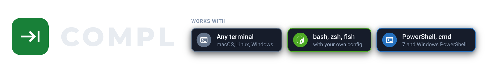
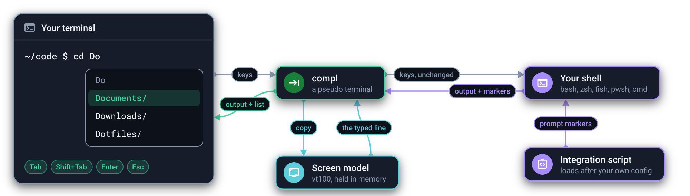
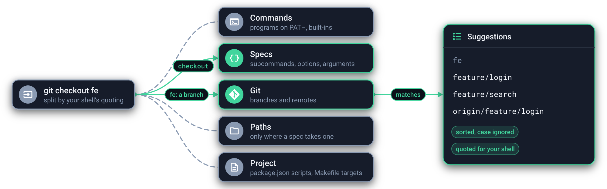

<picture><source media="(prefers-color-scheme: light)" srcset="docs/images/header-light.png"></picture>

<a href="docs/how-it-works.md"><picture><source media="(prefers-color-scheme: light)" srcset="docs/images/how-it-works-light.png"></picture></a>

<a href="docs/specs.md"><picture><source media="(prefers-color-scheme: light)" srcset="docs/images/suggestions-light.png"></picture></a>

## Installation

### macOS and Linux

```bash
curl -fsSL https://compl.krispowers.dev | sh
```

This installs the binary into `~/.local/bin` and adds compl to your shell's startup file.

### Windows

In PowerShell:

```powershell
irm https://compl.krispowers.dev | iex
```

This installs `compl.exe` into `%LOCALAPPDATA%\Programs\compl`, adds it to your PATH and adds compl to your PowerShell profile.

### Homebrew

```bash
brew tap krispowers/compl https://compl.krispowers.dev/brew
brew install compl
compl setup
```

Open a new terminal once installed. The installers accept a few environment variables, such as a pinned version; see [installation options](docs/installation.md).

## Usage

Start typing. When suggestions exist, a list shows under the cursor:

| Key | What it does |
| --- | --- |
| Tab | Move down the list and put that suggestion on the command line |
| Shift+Tab | Move up the list; the first row puts back what you typed |
| Down, Up | Down enters the list and moves down; Up moves up once you are in it |
| Enter | Run the command line as it stands |
| Esc | Put back what you typed and hide the list until you type again |

When no list is showing, every key behaves exactly as it does without compl, so Tab still reaches your shell's own completion. Up and Down outside the list go through history as usual, and a line recalled from history keeps its list hidden until you type.

To try compl without changing any startup file, run it directly:

```bash
compl run --shell zsh
```

Exit the shell as usual (`exit` or Ctrl+D) to leave it.

### Commands

| Command | What it does |
| --- | --- |
| `compl` | Start your shell with suggestions turned on |
| `compl run --shell <shell>` | Start a specific shell: `bash`, `zsh`, `fish`, `pwsh`, `powershell` or `cmd` |
| `compl setup [shell]` | Add compl to the shell's startup file |
| `compl setup [shell] --remove` | Take it out again |
| `compl init <shell>` | Print the snippet the startup file evaluates |
| `compl complete "<line>"` | Print the suggestions for a command line |

## Configuration

| Variable | Effect |
| --- | --- |
| `COMPL_DISABLE=1` | Start shells without compl, even with the startup line in place |

Suggestions for a command come from a small JSON spec. Adding or improving one is the easiest way to contribute; see [writing specs](docs/specs.md).

## Documentation

- [How it works](docs/how-it-works.md)
- [Shells and terminals](docs/shells.md)
- [Installation options](docs/installation.md)
- [Writing specs](docs/specs.md)
- [Troubleshooting](docs/troubleshooting.md)
